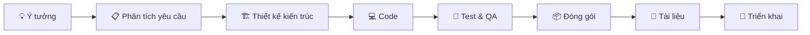
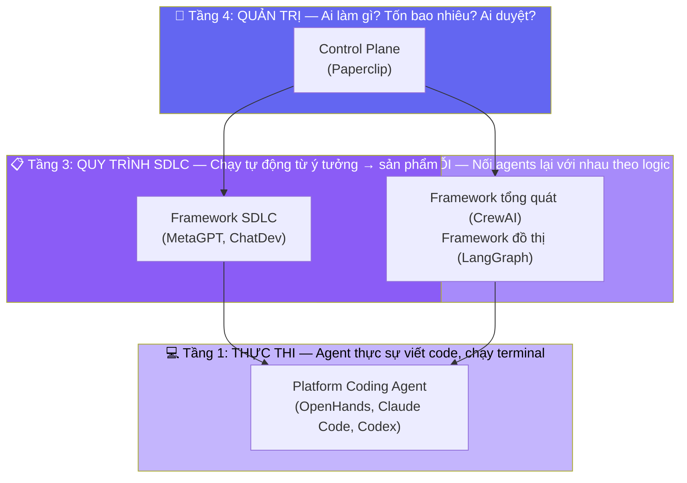
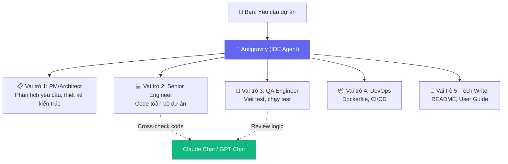
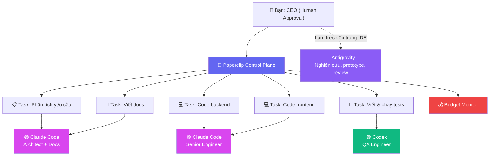

# 🤖 So sánh các Tools quản trị & điều phối Multi-AI Agent

## Bối cảnh: Xây dựng Team AI tự vận hành

Bạn cần một "công ty ảo" AI có thể tự động hoàn thành vòng đời phát triển phần mềm:



---

## 📊 Bảng so sánh tổng quan

| Tiêu chí | **Paperclip** | **MetaGPT** | **ChatDev** | **CrewAI** | **LangGraph** | **OpenHands** |
|:---|:---|:---|:---|:---|:---|:---|
| **Loại** | Control Plane (Lớp quản trị, giám sát, phê duyệt — không tự code) | Framework SDLC (Quy trình phát triển PM→Dev→QA đóng hộp sẵn) | Framework SDLC (Quy trình phát triển PM→Dev→QA đóng hộp sẵn) | Framework tổng quát (Chia role + task, bạn tự thiết kế flow) | Framework đồ thị (Vẽ flowchart trạng thái, kiểm soát tuyệt đối) | Platform coding agent (Agent thực sự ngồi code trong sandbox) |
| **Ngôn ngữ** | Node.js + React | Python | Python | Python | Python/TS | Python |
| **Giao diện** | ✅ Web UI (Kanban, Org Chart) | ❌ CLI | ❌ CLI | ❌ CLI/Code | ❌ Code | ✅ Web UI + VS Code |
| **Self-hosted** | ✅ Docker | ✅ | ✅ | ✅ | ✅ | ✅ Docker |
| **BYOA (Bring Your Own Agent)** | ✅ Claude Code, Codex, Gemini CLI, OpenCode, Cursor, Grok, Kimi, Hermes… (HTTP/webhook: *coming soon*) | ❌ Nội bộ | ❌ Nội bộ | Một phần | Một phần | ❌ Nội bộ |
| **Budget/Cost tracking** | ✅ Token spend, salary caps | ❌ | ❌ | ❌ | ❌ | Cơ bản |
| **Human-in-the-loop** | ✅ Approval gates | Hạn chế | Hạn chế | Cơ bản | ✅ Mạnh | ✅ |
| **Mức độ tự động hóa SDLC** | ⭐⭐⭐ | ⭐⭐⭐⭐⭐ | ⭐⭐⭐⭐⭐ | ⭐⭐⭐ | ⭐⭐ | ⭐⭐⭐⭐ |
| **Độ phức tạp cài đặt** | Thấp | Trung bình | Thấp | Thấp | Cao | Trung bình |
| **GitHub Stars** | ~4K+ | ~50K+ | ~25K+ | ~25K+ | ~15K+ | ~45K+ |

---

## 🧩 Giải thích phân loại: 5 loại tool khác nhau thế nào?

Các tool trên hoạt động ở **các tầng khác nhau** trong hệ thống, giống như các phòng ban trong một công ty thực:



### Tầng 1: Platform Coding Agent — "Lập trình viên thực sự"
> **So sánh:** 👨‍💻 Một lập trình viên ngồi trước máy tính, mở terminal, viết file, chạy test.

- **Là gì:** Agent chạy trong Docker sandbox, thực sự tạo file, execute code, đọc output, sửa lỗi
- **Làm được:** Viết code, chạy terminal, debug, browse web, tạo PR
- **Không làm được:** Không biết tổ chức workflow, không quản lý team, không tự chia task
- **Ví dụ:** OpenHands, Claude Code, Codex CLI
- **Ví dụ cụ thể:** Bạn nói *"Viết API endpoint /health-check bằng FastAPI"* → Agent tạo file, viết code, chạy test, trả kết quả

### Tầng 2a: Framework Tổng quát (CrewAI) — "Tổ trưởng chia việc"
> **So sánh:** 👨‍💼 Tổ trưởng nhận task lớn, chia cho từng người trong tổ, mỗi người có vai trò riêng.

- **Là gì:** Framework Python để định nghĩa agents với roles/goals, rồi để chúng tự phối hợp
- **Làm được:** Chia role (PM, Dev, Tester), delegate task, chạy sequential/hierarchical
- **Không làm được:** Không có template SDLC sẵn — phải tự thiết kế quy trình từ đầu
- **Dùng cho:** Bất kỳ lĩnh vực nào (marketing, data, research...) — không chỉ code

### Tầng 2b: Framework Đồ thị (LangGraph) — "Kỹ sư quy trình vẽ flowchart"
> **So sánh:** 📊 Kỹ sư quy trình vẽ sơ đồ: *"Nếu test fail → quay lại code → nếu pass → deploy"*

- **Là gì:** Framework xây state machine — mỗi node là 1 agent/tool, mỗi edge là điều kiện
- **Làm được:** Kiểm soát chính xác từng bước (if/else, loop, retry), lưu state, time-travel debug
- **Không làm được:** Không có template sẵn, phải tự code từng node/edge/state schema
- **Khác CrewAI:** CrewAI = "team tự phối hợp" (linh hoạt, khó dự đoán) vs LangGraph = "flowchart cứng" (deterministic, nhiều boilerplate)

| | **CrewAI (Tổng quát)** | **LangGraph (Đồ thị)** |
|:---|:---|:---|
| **Tư duy** | "Tôi có team, mỗi người có role" | "Tôi có flowchart, mỗi ô là 1 bước" |
| **Kiểm soát** | Agent tự quyết định delegate | Bạn quy định chính xác flow |
| **Ưu** | Nhanh, trực quan, dễ prototype | Chính xác, debug được, production-grade |
| **Nhược** | Khó dự đoán kết quả khi scale | Nhiều boilerplate, learning curve cao |
| **Ví von** | Mua LEGO rời tự lắp | Mua mô hình LEGO có hướng dẫn từng bước |

### Tầng 3: Framework SDLC — "Startup phần mềm đóng hộp"
> **So sánh:** 🏭 Một startup-in-a-box — bạn chỉ nói ý tưởng, cả "công ty" tự vận hành.

- **Là gì:** Framework có sẵn quy trình phát triển phần mềm hoàn chỉnh (PM → Architect → Dev → QA → Docs)
- **Làm được:** Nhận 1 câu prompt → tự sinh PRD, system design, code, test, tài liệu
- **Không làm được:** Khó tùy biến workflow, không có UI quản trị, không track budget
- **Khác Tầng 2:** Framework SDLC = template quy trình sẵn (chỉ cho dev). CrewAI/LangGraph = bộ công cụ xây quy trình bất kỳ.

| | **Tầng 2 (CrewAI/LangGraph)** | **Tầng 3 (MetaGPT/ChatDev)** |
|:---|:---|:---|
| **Scope** | Dùng cho **mọi lĩnh vực** | Chỉ cho **phát triển phần mềm** |
| **Quy trình** | Bạn **tự thiết kế** từ đầu | Đã có **template SDLC sẵn** |
| **Output** | Tuỳ bạn define | PRD + Design + Code + Test + Docs |
| **Ví von** | Mua bột, đường, trứng tự làm bánh | Mua hộp bánh mix — đổ nước vào là xong |

### Tầng 4: Control Plane — "Ban giám đốc + HR + Kế toán"
> **So sánh:** 🏢 Phòng HR + Tài chính + Ban giám đốc — không trực tiếp code, chỉ quản trị.

- **Là gì:** UI dashboard để quản lý AI agents (org chart, kanban, budget, approval)
- **Làm được:** Phân vai trò, giao task, theo dõi chi phí, phê duyệt, audit trail
- **KHÔNG làm được:** Không tự viết code, không tự test — chỉ điều phối agents khác
- **Bắt buộc cần:** Agent runtimes bên ngoài (Claude Code, OpenHands, Codex) để thực thi

> **Tóm tắt 1 câu cho mỗi loại:**
>
> | Loại | 1 câu | Vai trò công ty |
> |:---|:---|:---|
> | **Platform Coding Agent** | Thực sự ngồi code trong sandbox | 👨‍💻 Lập trình viên |
> | **Framework Tổng quát** | Chia role + task, team tự phối hợp | 👨‍💼 Tổ trưởng |
> | **Framework Đồ thị** | Vẽ flowchart trạng thái chính xác | 📊 Kỹ sư quy trình |
> | **Framework SDLC** | Cả quy trình PM→Dev→QA đóng hộp | 🏭 Startup-in-a-box |
> | **Control Plane** | Quản trị, ngân sách, phê duyệt | 🏢 Ban giám đốc + HR + Kế toán |
>
> ⚠️ **Quan trọng:** Các tầng **bổ sung cho nhau**, không thay thế. Setup mạnh nhất = Control Plane (quản trị) + Coding Agent (thực thi).

---

## 🔍 Phân tích chi tiết từng tool

### 1. 📎 Paperclip — "Virtual Company Control Plane"
> [github.com/paperclipai/paperclip](https://github.com/paperclipai/paperclip)

**Triết lý:** Quản lý AI agents như nhân viên trong công ty — có sơ đồ tổ chức, phân vai trò, theo dõi ngân sách.

**Cách hoạt động:**
- Tạo Org Chart: CEO → PM → Engineers → QA
- Gán agent runtime (adapter) cho từng agent: Claude Code, Codex, Gemini CLI, OpenCode, Cursor, Grok, Kimi, Hermes…
- Kết nối tài khoản AI trong **Connectors** (API key hoặc gói subscription)
- Theo dõi task qua Kanban board, approval gates
- Kiểm soát chi phí token với budget caps

**Ưu điểm:**
- ✅ UI đẹp, trực quan (giống Linear/Jira cho AI)
- ✅ Governance mạnh: budget caps, audit trails, approval gates
- ✅ BYOA — nhiều adapter có sẵn; Docker image đã kèm CLI `claude`, `codex`, `gemini`, `opencode`
- ✅ Dùng được **gói Claude Pro/Max** (Connectors → Anthropic → Claude Subscription) — không tốn phí API
- ✅ Self-hosted, data riêng tư

**Nhược điểm:**
- ❌ **Không phải framework** để build agent logic — chỉ là lớp quản trị
- ❌ Adapter HTTP/webhook chưa có (*coming soon*) → **chưa nối được Antigravity** hay agent tuỳ biến
- ❌ Gói **Google AI Pro không dùng được** qua Gemini CLI (Google trả `IneligibleTierError`, yêu cầu chuyển sang Antigravity) — Gemini chỉ chạy bằng API key
- ❌ Còn khá mới, community nhỏ
- ❌ Không tự sinh code hay test — phụ thuộc hoàn toàn vào agent backend

**Phù hợp cho use case của bạn:** ⭐⭐⭐⭐ — Rất tốt nếu bạn đã có agent runtimes (Claude Code, Codex) và cần lớp quản trị.

> Setup đang dùng trong repo: [paperclip/README.md](paperclip/README.md) (`./scripts/run.sh --setup`, dashboard `http://localhost:3100`).

---

### 2. 🧠 MetaGPT — "Code = SOP(Team)"
> [github.com/FoundationAgents/MetaGPT](https://github.com/FoundationAgents/MetaGPT)

**Triết lý:** Mã hóa quy trình SOP của công ty phần mềm thực thành prompt chains.

**Cách hoạt động:**
```
Ý tưởng → PM (PRD) → Architect (System Design) → Engineer (Code) → QA (Test)
```
- Các agent truyền tài liệu chuẩn (PRD, API specs, flowcharts) cho nhau
- Giảm hallucination bằng structured document handoffs

**Ưu điểm:**
- ✅ **End-to-end SDLC** từ 1 câu mô tả → code hoàn chỉnh
- ✅ Tạo PRD, system design, flowcharts tự động
- ✅ Giảm context drift nhờ truyền tài liệu chuẩn
- ✅ Community lớn (~50K stars), nhiều ví dụ

**Nhược điểm:**
- ❌ Chất lượng code phụ thuộc nhiều vào LLM backend
- ❌ Khó tùy biến workflow phức tạp
- ❌ Không có UI quản trị — chỉ CLI
- ❌ Budget/cost tracking không built-in

**Phù hợp cho use case của bạn:** ⭐⭐⭐⭐⭐ — **Phù hợp nhất** cho việc tự động hóa toàn bộ SDLC từ ý tưởng đến sản phẩm.

---

### 3. 🏢 ChatDev — "Virtual Software Company"
> [github.com/OpenBMB/ChatDev](https://github.com/OpenBMB/ChatDev)

**Triết lý:** Mô phỏng một công ty phần mềm với các "cuộc họp" (chat chains) giữa các vai trò.

**Cách hoạt động:**
```
CEO → CPO → CTO → Programmer → Designer → Reviewer → Tester
```
- Chia SDLC thành 4 pha: Design → Code → Test → Document
- Agents "họp" (multi-turn dialogue) để ra quyết định tập thể

**Ưu điểm:**
- ✅ Rất trực quan — mô phỏng đúng quy trình công ty thực
- ✅ Tự động sinh tài liệu sử dụng
- ✅ Dễ dùng — 1 lệnh chạy từ prompt đến code
- ✅ Có thể customize roles và phases

**Nhược điểm:**
- ❌ Chất lượng output kém hơn MetaGPT ở project phức tạp
- ❌ Waterfall cứng nhắc — khó thêm vòng lặp feedback
- ❌ Phù hợp hơn cho prototype/nhỏ, chưa production-ready
- ❌ Ít active development gần đây

**Phù hợp cho use case của bạn:** ⭐⭐⭐ — Tốt cho prototyping nhanh, nhưng thiếu governance cho production.

---

### 4. 👥 CrewAI — "Role-Based Agent Teams"
> [github.com/crewAIInc/crewAI](https://github.com/crewAIInc/crewAI)

**Triết lý:** Định nghĩa "crew" agents với roles, goals, backstories, rồi để chúng tự phối hợp.

**Ưu điểm:**
- ✅ API rất clean, dễ học
- ✅ Linh hoạt — dùng cho bất kỳ use case nào, không chỉ SDLC
- ✅ Hỗ trợ hierarchical và sequential workflows
- ✅ Tích hợp dễ với tools (browser, file, API)

**Nhược điểm:**
- ❌ **Cần tự code workflow** — không có SDLC template sẵn
- ❌ Khó kiểm soát khi scale nhiều agents
- ❌ Không có UI quản trị
- ❌ Kết quả có thể không deterministic

**Phù hợp cho use case của bạn:** ⭐⭐⭐ — Linh hoạt nhưng cần effort tự build pipeline SDLC.

---

### 5. 🔄 LangGraph — "State Machine Orchestrator"
> [github.com/langchain-ai/langgraph](https://github.com/langchain-ai/langgraph)

**Triết lý:** Agents là nodes trong đồ thị trạng thái, kết nối bằng conditional edges.

**Ưu điểm:**
- ✅ Kiểm soát tuyệt đối flow — deterministic
- ✅ State persistence, time-travel debugging
- ✅ Human-in-the-loop mạnh nhất
- ✅ Production-grade, dùng trong enterprise

**Nhược điểm:**
- ❌ **Learning curve rất cao**
- ❌ Cần viết rất nhiều boilerplate code
- ❌ Không có SDLC template — phải tự thiết kế từ đầu
- ❌ Over-engineering cho use case đơn giản

**Phù hợp cho use case của bạn:** ⭐⭐ — Quá low-level, trừ khi bạn muốn tự build platform từ scratch.

---

### 6. 🖥️ OpenHands — "Open-source AI Software Engineer"
> [github.com/All-Hands-AI/OpenHands](https://github.com/All-Hands-AI/OpenHands)

**Triết lý:** AI developer agent chạy trong Docker sandbox, tự viết code, chạy terminal, browse web.

**Ưu điểm:**
- ✅ Web UI đẹp, tích hợp VS Code
- ✅ Model-agnostic — chọn bất kỳ LLM
- ✅ Docker sandbox an toàn
- ✅ SWE-bench score cao (>70%)
- ✅ RBAC, audit trails cho enterprise

**Nhược điểm:**
- ❌ Thiên về **single agent** hơn multi-agent team
- ❌ Chưa có org chart hay role assignment
- ❌ Thiếu governance layer (budget caps, approval gates)

**Phù hợp cho use case của bạn:** ⭐⭐⭐⭐ — Rất mạnh cho coding, nhưng thiếu lớp quản trị team.

---

## 🎯 Khuyến nghị cá nhân hóa: Setup với tools bạn đã có

### Bạn đã có sẵn gì?

| Agent | Loại | Khả năng | Cách dùng |
|:---|:---|:---|:---|
| **Claude** (gói Pro) | LLM + Coding Agent | Code generation mạnh nhất, reasoning sâu, context dài | Claude Code CLI (`claude` trên terminal) — ✅ đã nối vào Paperclip |
| **GPT** | LLM + Coding Agent | Code generation, reasoning, multi-modal | Codex CLI (`codex` trên terminal) |
| **Antigravity** (gói Google AI Pro) | IDE Coding Agent | Code, terminal, browser, file system, image gen — tất cả trong IDE | Đang dùng ngay trong IDE — ⚠️ chưa nối được vào Paperclip |

> [!NOTE]
> Bạn đã có đủ **Tầng 1 (Thực thi)** — 3 coding agents mạnh. Thiếu duy nhất **Tầng 4 (Quản trị)** nếu cần scale lên nhiều dự án.
>
> Gói Google AI Pro chỉ dùng được qua Antigravity; Gemini CLI (adapter Gemini của Paperclip) đã bị Google chặn cho tài khoản cá nhân.

---

### ⭐ Phương án A: Zero tool thêm — Dùng ngay những gì đã có (Dự án nhỏ/vừa)

Dùng **Antigravity** làm "điều phối viên" kiêm nhiều vai trò:



**Cách hoạt động:**
1. Bạn nói yêu cầu → Antigravity phân tích, thiết kế, code, test, viết docs — **tất cả trong IDE**
2. Khi cần review/cross-check → copy sang Claude/GPT chat để kiểm tra lại
3. Quản lý task bằng `TODO.md` hoặc GitHub Issues

**Workflow cụ thể cho System Monitor Tool:**

```
Bước 1: Bạn → Antigravity: "Build system monitoring tool với CPU, RAM, Disk, Network"
Bước 2: Antigravity: Phân tích → tạo PRD → thiết kế kiến trúc → code
Bước 3: Antigravity: Viết unit tests → chạy tests → fix bugs
Bước 4: Antigravity: Tạo Dockerfile → docker-compose.yml
Bước 5: Antigravity: Viết README.md → User Guide
Bước 6: Bạn: Copy code quan trọng → paste vào Claude/GPT để review
```

| Ưu điểm | Nhược điểm |
|:---|:---|
| ✅ Zero setup, dùng ngay | ❌ Không parallel execution — 1 agent làm tuần tự |
| ✅ Không tốn thêm chi phí | ❌ Không có budget/cost tracking tự động |
| ✅ Tất cả trong 1 IDE | ❌ Không có approval gates tự động |
| ✅ Đủ cho dự án vừa/nhỏ | ❌ Khó scale khi có nhiều dự án cùng lúc |

---

### ⭐⭐ Phương án B: +1 tool duy nhất — Paperclip (Dự án lớn / Vận hành dài hạn)

Thêm **Paperclip** làm lớp quản trị cho Claude Code + Codex. Antigravity hiện **chưa nối được** vào Paperclip (adapter HTTP/webhook *coming soon*), nên vẫn dùng song song trong IDE:



**Phân vai trò chi tiết:**

| Vai trò trong team | Gán cho Agent | Lý do chọn |
|:---|:---|:---|
| **PM / Architect** | Claude Code (Paperclip) | Reasoning sâu, context dài, tự đọc codebase để thiết kế |
| **Senior Engineer** | Claude Code (Paperclip) | Code generation mạnh nhất, tự chạy terminal, tự fix lỗi |
| **QA / Reviewer** | Codex (Paperclip) | Review code từ Claude bằng model khác, viết test cases, chạy test suites |
| **DevOps + Tech Writer** | Claude Code (Paperclip) | Tạo Dockerfile, CI/CD configs, viết README, user guide |
| **Nghiên cứu / prototype** | Antigravity (ngoài Paperclip) | Có browser, image gen, IDE — dùng thủ công cho tới khi Paperclip có adapter HTTP |
| **Quản trị tổng** | Paperclip | Giao task, track budget, approval gates, audit log |

> [!WARNING]
> Các agent Claude Code trong Paperclip dùng **chung 1 gói Claude Pro** → chung giới hạn 5 giờ / tuần. Chạy nhiều agent song song sẽ chạm giới hạn nhanh hơn; cân nhắc gói Max hoặc API key cho agent chạy nhiều.

**Setup cụ thể (chỉ 3 bước)** — chi tiết trong [paperclip/README.md](paperclip/README.md):

```bash
# Bước 1: Chạy Paperclip (Docker) — trong terminal Linux / WSL
cd <repo>/ai-agent-orchestration/paperclip
./scripts/run.sh --setup
# → Mở http://localhost:3100
# Không cần cài CLI trên máy: image đã có sẵn claude, codex, gemini, opencode

# Bước 2: Kết nối tài khoản AI trong UI → Connectors
#   Anthropic → Claude Subscription → chạy lệnh Paperclip hiển thị trong container
#     docker exec -it -u node paperclip-server sh -c '<lệnh>'
#   OpenAI    → kết nối tài khoản cho Codex

# Bước 3: Trong Paperclip UI, tạo Org Chart:
#
#   👤 CEO (Bạn - Human Approval)
#   ├── 🟣 Architect    → Claude Code
#   ├── 🟣 Engineer     → Claude Code
#   ├── 🟢 QA           → Codex
#   └── 🟣 Tech Writer  → Claude Code
#
# Mỗi agent: Harness / Runtime → chọn AI connection → Run test
# Set budget caps cho mỗi agent (ví dụ: 100K tokens/task)
# Bật approval gates cho các task quan trọng (deploy, merge)
```

| Ưu điểm | Nhược điểm |
|:---|:---|
| ✅ Parallel execution — nhiều agent làm đồng thời | ❌ Cần chạy Paperclip (Docker) |
| ✅ Budget tracking tự động | ❌ Paperclip còn mới, community nhỏ |
| ✅ Approval gates — bạn duyệt trước khi merge | ❌ Cần maintain thêm 1 service |
| ✅ Audit trail — xem lại ai làm gì | ❌ Chưa nối được Antigravity (chờ adapter HTTP) |
| ✅ Scale được nhiều dự án cùng lúc | ❌ Agent Claude dùng chung giới hạn gói subscription |

---

### So sánh 2 phương án

| Tiêu chí | **Phương án A** (Zero tool thêm) | **Phương án B** (+Paperclip) |
|:---|:---|:---|
| **Số tool cần thêm** | 0 | 1 (Paperclip) |
| **Thời gian setup** | 0 phút | ~15 phút |
| **Parallel execution** | ❌ Tuần tự | ✅ Nhiều agents đồng thời |
| **Budget tracking** | ❌ Thủ công | ✅ Tự động |
| **Human approval** | ❌ Thủ công | ✅ Approval gates |
| **Phù hợp cho** | 1 dự án, prototype | Nhiều dự án, production |
| **Khuyến nghị** | Bắt đầu với cái này trước | Chuyển sang khi cần scale |

---

## 💡 Bảng quyết định nhanh

| Nếu bạn muốn... | Chọn |
|:---|:---|
| Dùng ngay, không cần setup gì | **Antigravity** (đã có) — Phương án A |
| Quản trị team AI, budget, approval | **+Paperclip** (thêm 1 tool) — Phương án B |
| Chạy 1 lệnh → ra sản phẩm hoàn chỉnh | **MetaGPT** (thêm 1 tool, thay thế phương án A) |
| Tự build pipeline riêng, linh hoạt | **CrewAI** (thêm 1 tool, cần effort code) |
| Agent coding mạnh nhất, model-agnostic | **OpenHands** (thêm 1 tool, thay Claude Code) |
| Kiểm soát tuyệt đối flow, enterprise | **LangGraph** (thêm 1 tool, learning curve cao) |
| Prototype nhanh, dễ hiểu | **ChatDev** (thêm 1 tool, output chất lượng thấp) |
| **Combo tối ưu cho bạn** | **Paperclip (Claude Code + Codex) + Antigravity dùng song song trong IDE** |

---

## 🔗 Links tham khảo

| Tool | GitHub | Docs |
|:---|:---|:---|
| Paperclip | [paperclipai/paperclip](https://github.com/paperclipai/paperclip) | [paperclip.ing](https://paperclip.ing) |
| MetaGPT | [FoundationAgents/MetaGPT](https://github.com/FoundationAgents/MetaGPT) | [docs.deepwisdom.ai](https://docs.deepwisdom.ai) |
| ChatDev | [OpenBMB/ChatDev](https://github.com/OpenBMB/ChatDev) | [chatdev.ai](https://chatdev.ai) |
| CrewAI | [crewAIInc/crewAI](https://github.com/crewAIInc/crewAI) | [docs.crewai.com](https://docs.crewai.com) |
| LangGraph | [langchain-ai/langgraph](https://github.com/langchain-ai/langgraph) | [langchain-ai.github.io/langgraph](https://langchain-ai.github.io/langgraph/) |
| OpenHands | [All-Hands-AI/OpenHands](https://github.com/All-Hands-AI/OpenHands) | [docs.all-hands.dev](https://docs.all-hands.dev) |
| Claude Code | [anthropics/claude-code](https://github.com/anthropics/claude-code) | [docs.anthropic.com](https://docs.anthropic.com/en/docs/claude-code) |
| Codex CLI | [openai/codex](https://github.com/openai/codex) | [platform.openai.com](https://platform.openai.com/docs) |

> [!TIP]
> **Lộ trình khuyến nghị cho bạn:**
> 1. **Ngay bây giờ:** Dùng **Phương án A** (Antigravity + Claude/GPT chat) để build System Monitor Tool
> 2. **Khi cần scale:** Dùng **Paperclip** (đã cài, agent Claude Code chạy bằng gói Pro) → chuyển sang **Phương án B** với Claude Code + Codex chạy song song
> 3. **Khi Paperclip có adapter HTTP/webhook:** nối Antigravity vào làm Architect / Tech Writer như kế hoạch ban đầu
> 4. **Dài hạn:** Đánh giá lại sau 2-3 dự án, cân nhắc thêm MetaGPT nếu cần SDLC tự động hoàn toàn
